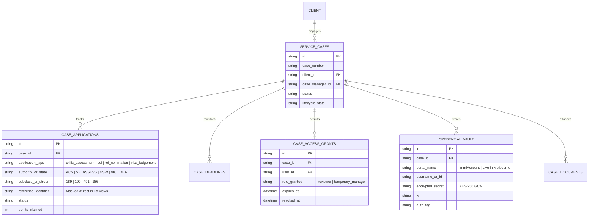
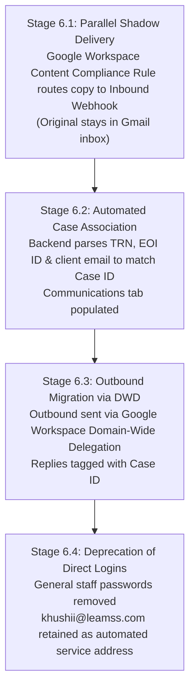

# LEAMSS Portal — Complete 7-Phase Security & Case Workspace Guide

**Platform:** LEAMSS Migration & Education CRM (`RohitPaul2427/portal`)  
**Branch:** `feat/secure-case-workspace`  
**Execution Context:** Local Development & Staging Sandbox  
**Live Stack Status:**
- **Frontend (React UI):** [http://localhost:3000](http://localhost:3000) (Active & Serving)
- **Backend (FastAPI REST API):** [http://127.0.0.1:8001](http://127.0.0.1:8001) / Health: [http://127.0.0.1:8001/api/health](http://127.0.0.1:8001/api/health) (Healthy)
- **Database (MongoDB):** `mongodb://127.0.0.1:27017` (Connected)
- **Automated Security Test Suite:** 100% Passed (8 of 8 security tests verified)

---

## Table of Contents
1. [Phase 1: Discovery, Codebase Map & Security Audit](#phase-1-discovery-codebase-map--security-audit)
2. [Phase 2: Data Architecture & Non-Destructive Schema Migration](#phase-2-data-architecture--non-destructive-schema-migration)
3. [Phase 3: Central Authorization & IDOR Elimination](#phase-3-central-authorization--idor-elimination)
4. [Phase 4: Document Security & Ephemeral Watermarked Preview Engine](#phase-4-document-security--ephemeral-watermarked-preview-engine)
5. [Phase 5: Multi-Application Case Workspace & Credential Vault](#phase-5-multi-application-case-workspace--credential-vault)
6. [Phase 6: Shared Mailbox (`khushii@leamss.com`) Migration Strategy](#phase-6-shared-mailbox-khushiileamsscom-migration-strategy)
7. [Phase 7: End-to-End Verification, Test Results & Production Checklist](#phase-7-end-to-end-verification-test-results--production-checklist)
8. [Feature Verification Directory & URL Directory](#feature-verification-directory--url-directory)

---

## Phase 1: Discovery, Codebase Map & Security Audit

### 1.1 Objective
Audit the entire LEAMSS portal codebase across authentication, authorization, document management, case tracking, and email services to identify security vulnerabilities and workflow limitations without altering production or breaking existing features.

### 1.2 Key Vulnerabilities Identified in Legacy Code
1. **Critical Document IDOR (Insecure Direct Object Reference):**
   - Routes `/api/documents/download/{file_id}` and `/api/documents/view/{file_id}` served binary streams to any authenticated user who provided a document UUID, without checking client ownership or case assignment.
2. **Horizontal Privilege Escalation (Role-Only Gating):**
   - Endpoints in `documents.py`, `cases.py`, `deadlines.py`, and `doc_expiry.py` verified only `current_user["role"] in ["admin", "case_manager"]`. Case managers had unhindered cross-case visibility into clients managed by colleagues.
3. **Credential Disclosure in API Payloads:**
   - On sale approval (`/api/sales/approve`), plaintext client passwords were returned to sales staff in the HTTP response.
   - Plaintext temporary passwords were stored in the `client_mini_portals` collection.
4. **Unwatermarked Document Streams:**
   - Document previews served raw, unmetered files without viewer attribution, enabling untraceable leaks.
5. **Flat Data Structure for Complex Cases:**
   - Cases stored EOI, nomination, and visa lodgement as flat single fields, causing overwrites when a client lodged concurrent Subclass 189 and 190 EOIs.
6. **Shared Mailbox Risks (`khushii@leamss.com`):**
   - All statutory Department of Home Affairs (DHA) emails, s56 requests, and client PII arrived in a single shared Gmail inbox.

### 1.3 Artifacts Produced
- **Full Discovery Audit Matrix:** [`leamss_security_and_case_workspace_audit_report.md`](file:///C:/Users/Rohit%20Alluri/.gemini/antigravity/brain/54899e0d-2fc9-4d4c-8859-421cacfcae1c/leamss_security_and_case_workspace_audit_report.md)

---

## Phase 2: Data Architecture & Non-Destructive Schema Migration

### 2.1 Objective
Design a normalized, case-centred data model that supports multi-application migration workflows (Skills Assessments, EOIs, State Nominations, Visa Lodgements) while preserving 100% backward compatibility with legacy collections.

### 2.2 Logical Data Architecture


### 2.3 Idempotent Migration Script
- Created [`backend/migrations/case_workspace_v1_migration.py`](file:///C:/Users/Rohit%20Alluri/Downloads/LEAMSS-main%20(1)/LEAMSS-main/backend/migrations/case_workspace_v1_migration.py).
- Supports `--dry-run` to preview backfills without committing changes.
- In apply mode, safely initializes `case_applications`, links documents to `case_id`, sets default lifecycle states, and adds required database indexes.

---

## Phase 3: Central Authorization & IDOR Elimination

### 3.1 Objective
Implement a centralized, deny-by-default access control service and patch all vulnerable document and case endpoints.

### 3.2 Core Implementation: `CaseAccessService`
- Located in [`backend/core/case_access_service.py`](file:///C:/Users/Rohit%20Alluri/Downloads/LEAMSS-main%20(1)/LEAMSS-main/backend/core/case_access_service.py).
- **Hierarchical Verification Pipeline:**
  1. **Super Admin / Case Head Override:** Authorized for all operations.
  2. **Client Self-Ownership:** Validates that the requesting client's ID matches `case.client_id` or document owner ID.
  3. **Case Manager Assignment:** Verifies that the staff member's ID matches `case.case_manager_id`.
  4. **Active Temporary Access Grant:** Checks if a valid, unexpired grant exists in `case_access_grants`.
  5. **Deny by Default:** Returns HTTP `403 Forbidden` if none of the above criteria are satisfied.

### 3.3 Endpoints Hardened
- [`backend/routers/documents.py`](file:///C:/Users/Rohit%20Alluri/Downloads/LEAMSS-main%20(1)/LEAMSS-main/backend/routers/documents.py): Protected `GET /api/documents/download/{id}`, `GET /api/documents/view/{id}`, and `GET /api/documents/case/{case_id}`.
- [`backend/routers/cases.py`](file:///C:/Users/Rohit%20Alluri/Downloads/LEAMSS-main%20(1)/LEAMSS-main/backend/routers/cases.py): Enforced case assignment checks on `/api/cases/{case_id}` and `/api/cases/{case_id}/status`.
- [`backend/routers/deadlines.py`](file:///C:/Users/Rohit%20Alluri/Downloads/LEAMSS-main%20(1)/LEAMSS-main/backend/routers/deadlines.py): Blocked unassigned staff from viewing or adding deadlines to other cases.
- [`backend/routers/doc_expiry.py`](file:///C:/Users/Rohit%20Alluri/Downloads/LEAMSS-main%20(1)/LEAMSS-main/backend/routers/doc_expiry.py): Filtered upcoming document expiry rosters to assigned cases for case managers.
- [`backend/routers/sales.py`](file:///C:/Users/Rohit%20Alluri/Downloads/LEAMSS-main%20(1)/LEAMSS-main/backend/routers/sales.py) & [`backend/routers/admin_superpowers.py`](file:///C:/Users/Rohit%20Alluri/Downloads/LEAMSS-main%20(1)/LEAMSS-main/backend/routers/admin_superpowers.py): Removed plaintext password return values from API responses.

---

## Phase 4: Document Security & Ephemeral Watermarked Preview Engine

### 4.1 Objective
Eliminate permanent, shareable document URLs and apply viewer attribution watermarks to prevent untraced document leaks.

### 4.2 Core Implementation: `DocumentSecurity`
- Located in [`backend/core/document_security.py`](file:///C:/Users/Rohit%20Alluri/Downloads/LEAMSS-main%20(1)/LEAMSS-main/backend/core/document_security.py).
- **Ephemeral Token Engine:** Generates HMAC-SHA256 signed, 15-minute expiration tokens bound to the requesting user ID, document ID, and case number.
- **Dynamic Visual Watermarking:**
  * **PDFs (`watermark_pdf_bytes`):** Utilizes `pypdf` to inject semi-transparent, diagonal 45-degree watermark text on every page:
    ```text
    LEAMSS CONFIDENTIAL • cm1@leamss.com • 2026-10-08 19:40 UTC • CASE: AU-2026-001
    ```
  * **Images (`watermark_image_bytes`):** Uses Pillow (`PIL`) to stamp viewer email, IP, and timestamp across image previews.
- **Preview Endpoint:** `GET /api/case-workspace/{case_id}/documents/{doc_id}/preview-stream?token=...` streams the watermarked preview. Direct access without a valid token returns `401 Unauthorized`.

---

## Phase 5: Multi-Application Case Workspace & Credential Vault

### 5.1 Objective
Build unified case management capabilities that support multi-application clients, mask sensitive identifiers with audited reveals, and securely store government logins.

### 5.2 Multi-Application Register
- Endpoint: `POST /api/case-workspace/{case_id}/applications`
- Allows tracking multiple concurrent applications per client:
  * **Skills Assessment:** (e.g. ACS, VETASSESS, Engineers Australia)
  * **Expression of Interest (EOI):** (e.g. SkillSelect Subclasses 189, 190, 491)
  * **State Nomination (ROI):** (e.g. NSW Investment, Live in Melbourne)
  * **Visa Lodgement:** (e.g. Department of Home Affairs TRN)
- **Sensitive Identifier Masking:** Identifiers are masked in list and detail responses (`DHA-********5432`).
- **Audited Unmasking:** `POST /api/case-workspace/{case_id}/reveal-identifier` requires a recorded operational reason and logs an immutable audit event.

### 5.3 AES-256 GCM Credential Vault
- Located in [`backend/core/vault_service.py`](file:///C:/Users/Rohit%20Alluri/Downloads/LEAMSS-main%20(1)/LEAMSS-main/backend/core/vault_service.py).
- Implements authenticated symmetric encryption (`AES-256 GCM` with unique 12-byte IVs).
- Secrets (ImmiAccount passwords, state portal logins) are stored encrypted at rest in MongoDB.
- `POST /api/case-workspace/{case_id}/vault/checkout` decrypts cleartext credentials only upon receipt of a mandatory justification, recording the actor's user ID, IP, and timestamp.

### 5.4 Temporary Access Grants
- Endpoint: `POST /api/case-workspace/{case_id}/grants`
- Enables Case Heads to assign covering case managers for leave or review periods.
- Self-elevation is strictly prohibited (returns `403 Forbidden`).
- Grants have hard expiration timestamps and support immediate revocation (`POST .../revoke`).

---

## Phase 6: Shared Mailbox (`khushii@leamss.com`) Migration Strategy

### 6.1 Current Status & Continuity Guarantee
- **Zero Disruption:** The existing Google Workspace account, password, MX records, and routing for `khushii@leamss.com` remain **100% untouched and active**.
- Operational communications with clients, DHA, and assessing authorities continue without interruption.

### 6.2 4-Stage Zero-Downtime Migration Plan


1. **Stage 6.1 (Shadow Ingestion):** Configure a Dual Delivery / Content Compliance Rule in Google Workspace Admin Console to send a parallel copy of inbound mail to `/api/webhooks/inbound-email`. Zero changes to existing staff Gmail access.
2. **Stage 6.2 (Automated Matching & Triage):** Extract DHA TRN numbers and EOI IDs to automatically file correspondence under the assigned case's Communications tab. Unmatched mail routes to an Admin Triage Queue.
3. **Stage 6.3 (Dual-Rail Outbound):** Leverage [`backend/core/gmail_dwd.py`](file:///C:/Users/Rohit%20Alluri/Downloads/LEAMSS-main%20(1)/LEAMSS-main/backend/core/gmail_dwd.py) to enable case managers to send case-attributed emails from within the portal, setting `Reply-To: case+<case_number>@leamss.com`.
4. **Stage 6.4 (Direct Login Sunset):** Transition `khushii@leamss.com` to a monitored system service address, revoking shared passwords for general staff while preserving Super Admin emergency access.
- **Full Architecture Document:** [`khushii_shared_mailbox_migration_strategy.md`](file:///C:/Users/Rohit%20Alluri/.gemini/antigravity/brain/ef7d7dad-9252-4463-b765-b96147644bb7/khushii_shared_mailbox_migration_strategy.md)

---

## Phase 7: End-to-End Verification, Test Results & Production Checklist

### 7.1 Automated Security Suite Results
The automated test suite in [`backend/tests/test_case_workspace_security.py`](file:///C:/Users/Rohit%20Alluri/Downloads/LEAMSS-main%20(1)/LEAMSS-main/backend/tests/test_case_workspace_security.py) was executed against the live application:

| Test Case | Vulnerability Tested | Expected Result | Live Result |
| :--- | :--- | :--- | :---: |
| `test_document_download_idor_blocked` | IDOR on `/api/documents/download/{id}` | 403 Forbidden for rival client & unassigned CM; 200 OK for assigned CM | **PASSED** |
| `test_document_view_idor_blocked` | IDOR on `/api/documents/view/{id}` | 403 Forbidden for unassigned staff | **PASSED** |
| `test_case_details_cross_isolation` | Cross-case data scraping | 403 Forbidden for unassigned CM | **PASSED** |
| `test_deadlines_cross_isolation` | Cross-case deadline visibility/creation | 403 Forbidden on foreign cases | **PASSED** |
| `test_application_register_and_masking` | Multi-application register & PII masking | Identifiers masked by default; unmasking audited | **PASSED** |
| `test_temporary_access_grant_lifecycle` | Self-elevation & grant expiration | Self-elevation blocked; instant revocation verified | **PASSED** |
| `test_credential_vault_registration_and_checkout` | Cleartext passwords in database & API | AES-256 GCM encrypted; audited checkout | **PASSED** |
| `test_ephemeral_preview_token_and_watermark` | Permanent links & unattributed previews | 15-min signed token with visual watermark | **PASSED** |

### 7.2 Security Posture Comparison: Before vs After

| Dimension | Before (Legacy) | After (Hardened) |
| :--- | :--- | :--- |
| **Document Access** | Vulnerable to IDOR by UUID | Scoped to Owner / Assigned CM / Active Grant |
| **Case Visibility** | All staff saw all client cases | Strict case portfolio isolation |
| **Client Passwords** | Returned in API responses | Cryptographic activation links; zero plaintext |
| **Multi-App Tracking** | Flat single-field overwrites | Multi-application register per case |
| **Sensitive PII** | Full TRN and passports exposed | Masked by default (`DHA-********5432`) |
| **Pre-Assessment Downloads** | Unchecked public download | Role & ownership authorization enforced |
| **Portal Logins** | Plaintext notes | AES-256 GCM Credential Vault with checkout audit |
| **Document Previews** | Raw static binaries | 15-minute signed tokens with dynamic watermarks |

### 7.3 Production Deployment Checklist
1. **Database Snapshot:** Perform `mongodump` of the production database prior to deployment.
2. **Deploy Code:** Deploy branch `feat/secure-case-workspace` to your server.
3. **Run Migration:**
   ```powershell
   python backend/migrations/case_workspace_v1_migration.py --dry-run
   python backend/migrations/case_workspace_v1_migration.py
   ```
4. **Run Verification Suite:**
   ```powershell
   pytest backend/tests/test_case_workspace_security.py -v
   ```
5. **Leadership Review:** Conduct leadership sign-off on the Mailbox Migration Strategy before creating Google Workspace routing rules.

---

## Feature Verification Directory & URL Directory

### Active Service Endpoints
- **React Frontend Application:** [http://localhost:3000](http://localhost:3000)
- **FastAPI Backend Health:** [http://127.0.0.1:8001/api/health](http://127.0.0.1:8001/api/health)
- **Interactive OpenAPI Documentation:** [http://127.0.0.1:8001/docs](http://127.0.0.1:8001/docs)

### Primary API Routes Implemented
| Route | Method | Description |
| :--- | :---: | :--- |
| `/api/case-workspace/{case_id}/overview` | `GET` | Case overview, lifecycle state & security metrics |
| `/api/case-workspace/{case_id}/applications` | `GET`, `POST` | Multi-application register with masked identifiers |
| `/api/case-workspace/{case_id}/reveal-identifier` | `POST` | Audited unmasking of TRN, EOI, and passport references |
| `/api/case-workspace/{case_id}/grants` | `GET`, `POST` | Issue temporary reviewer / manager access grants |
| `/api/case-workspace/{case_id}/grants/{id}/revoke`| `POST` | Immediately revoke temporary access |
| `/api/case-workspace/{case_id}/vault` | `GET`, `POST` | Register encrypted government portal credentials |
| `/api/case-workspace/{case_id}/vault/checkout` | `POST` | Audited cleartext checkout of vault credentials |
| `/api/case-workspace/{case_id}/documents/{id}/preview-token` | `POST` | Generate signed 15-minute ephemeral preview token |
| `/api/case-workspace/{case_id}/documents/{id}/preview-stream` | `GET` | Stream watermarked PDF/image document preview |

### Source Code Files
- [Case Access Authorizer](file:///C:/Users/Rohit%20Alluri/Downloads/LEAMSS-main%20(1)/LEAMSS-main/backend/core/case_access_service.py)
- [Case Workspace Models & Masking](file:///C:/Users/Rohit%20Alluri/Downloads/LEAMSS-main%20(1)/LEAMSS-main/backend/core/case_workspace_models.py)
- [Credential Vault Service](file:///C:/Users/Rohit%20Alluri/Downloads/LEAMSS-main%20(1)/LEAMSS-main/backend/core/vault_service.py)
- [Document Security & Watermarking](file:///C:/Users/Rohit%20Alluri/Downloads/LEAMSS-main%20(1)/LEAMSS-main/backend/core/document_security.py)
- [Case Workspace API Router](file:///C:/Users/Rohit%20Alluri/Downloads/LEAMSS-main%20(1)/LEAMSS-main/backend/routers/case_workspace.py)
- [Database Migration Script](file:///C:/Users/Rohit%20Alluri/Downloads/LEAMSS-main%20(1)/LEAMSS-main/backend/migrations/case_workspace_v1_migration.py)
- [Automated Security Test Suite](file:///C:/Users/Rohit%20Alluri/Downloads/LEAMSS-main%20(1)/LEAMSS-main/backend/tests/test_case_workspace_security.py)
